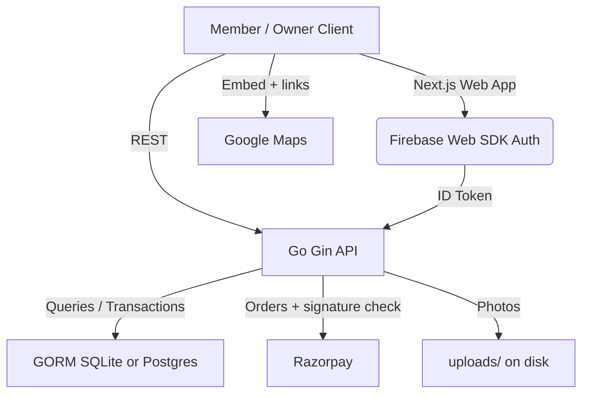

# GymPass Prime 🏋️‍♂️💳

[](https://golang.org)
[](https://nextjs.org)
[](https://react.dev)
[](https://gorm.io)
[](https://firebase.google.com)
[](https://razorpay.com)

**GymPass Prime** is a gym marketplace. Gym owners register their gym, publish plans and prices and run the front desk from a dashboard. Members find the nearest gyms, buy hours, months or years of access, and get in with a QR code.

Designed with a **Matte Black and Gold** look: smooth transitions, parallax layers and a canvas particle trail.

---

## How it works

**Members**
* Sign in with a phone OTP (Firebase), then open **Gyms** to see gyms nearest to you. The search icon finds a gym by name, area or city.
* Each gym page shows photos, a Google Maps view with directions, and its plans.
* Pay with **GPay, Paytm or any UPI app** (Razorpay checkout), or **request cash payment** and let the owner approve it.
* The main dashboard lists every membership with time remaining. Prepaid hours count down live while you are inside.
* Show your QR at the gym to **punch in**, scan again to **punch out**. The QR is single-use and valid for 60 seconds.
* Notifications warn you before a plan ends (3 days and 1 day for date plans, 2 hours and 30 minutes for prepaid hours).

**Plans**
* **Prepaid hours** (for example 5 h): only the time you actually spend inside is deducted, however many days it spans. Price is per hour; the owner chooses whether hours expire.
* **Monthly / quarterly / half-yearly / yearly**: fixed duration from the day of purchase.
* Buying the same plan at the same gym again extends it.

**Gym owners** (email + password, separate from members)
* Register a gym with name, address and a map location (use my location, paste a Google Maps link, or enter coordinates), plus optional photos.
* Set plan types and prices. One owner can run several gyms.
* Dashboard: who is inside right now, busiest hours (today and 30-day average), entries, members, revenue, recent visits and payments.
* Scan members at the door with the camera (or paste a code), approve or reject cash requests, browse members, visits and payments.
* A visit that is never punched out is closed automatically after `MAX_SESSION_HOURS` (default 6) so a forgotten scan cannot drain prepaid hours.

---

## System Architecture



---

## Installation & Local Setup

### Prerequisite Environment
- **Go**: Version `1.25` or higher (see `backend/go.mod`).
- **NodeJS**: Version `20` or higher.
- **SQLite**: Automatic setup managed by GORM.

---

### 1. Backend Server Setup

1. Navigate to the backend directory:
   ```bash
   cd backend
   ```
2. Copy the configuration environment variables template:
   ```bash
   cp .env.example .env
   ```
3. Edit the `.env` file. For local development the defaults in `.env.example` work as they are:
   ```env
   PORT=8080
   JWT_SECRET=change_me
   DEV_MODE=true            # any 6-digit OTP works, Razorpay is mocked, demo data is seeded
   RAZORPAY_KEY_ID=rzp_test_mock_id_123
   RAZORPAY_KEY_SECRET=rzp_test_mock_secret_abc
   FIREBASE_PROJECT_ID=your_firebase_project_id
   ```
   `DEV_MODE` is **off by default**. Never run production with it on.
4. Fetch dependencies and run the server (GORM will auto-migrate and seed the database tables):
   ```bash
   go run main.go
   ```

---

### 2. Frontend Web App Setup

1. Navigate to the frontend directory:
   ```bash
   cd ../frontend
   ```
2. Copy the environment variables template:
   ```bash
   cp .env.example .env.local
   ```
3. Add your Firebase Web config keys to `.env.local`:
   ```env
   NEXT_PUBLIC_API_URL=http://localhost:8080/api
   NEXT_PUBLIC_FIREBASE_API_KEY=your_firebase_api_key
   NEXT_PUBLIC_FIREBASE_AUTH_DOMAIN=your_firebase_auth_domain
   NEXT_PUBLIC_FIREBASE_PROJECT_ID=your_firebase_project_id
   NEXT_PUBLIC_FIREBASE_STORAGE_BUCKET=your_firebase_storage_bucket
   NEXT_PUBLIC_FIREBASE_MESSAGING_SENDER_ID=your_firebase_messaging_sender_id
   NEXT_PUBLIC_FIREBASE_APP_ID=your_firebase_app_id
   ```
4. Install npm packages and start the developer hot-reload server:
   ```bash
   npm install
   npm run dev
   ```
5. Open your browser to **`http://localhost:3000`**.

---

### Demo data (DEV_MODE)

On first start the server seeds an owner and two Bengaluru gyms with plans:

* Owner login at `/owner/login`: `owner@gympass.com` / `owner12345`
* Members sign in at `/auth` with any phone number and any 6-digit OTP.

If you used an older version of this project, delete `backend/database/gympass.db` once: the schema changed.

### Trying it end to end

1. Sign in as a member, open **Gyms**, buy a plan (mock payment) or send a cash request.
2. Sign in as the owner in another browser profile, approve the cash request, open **Scan**.
3. Paste the member's QR code (the member dashboard shows a new one every 60 s) to punch in, scan another to punch out.

### Payments

Razorpay's checkout offers Google Pay, Paytm, PhonePe, other UPI apps, cards and netbanking once real keys are set. All online payments go to the single Razorpay account in `.env`. Paying each gym owner directly needs Razorpay Route (not included).

### Maps

The map is Google Maps' keyless embed plus "Open in Google Maps" and "Directions" links, so no API key is needed. Owners set the pin with browser location, a pasted Maps link or coordinates; address search and autocomplete would need a Maps Platform key.

---

## Core API Endpoints

Full list in `backend/README.md`.

* Public: `POST /api/auth/send-otp`, `POST /api/auth/verify-otp`, `POST /api/owner/register`, `POST /api/owner/login`
* Member (`/api/user/...`): `dashboard`, `qr`, `gyms`, `gyms/:id`, `payments/initiate`, `payments/verify`, `memberships/cash-request`, `requests/:id/cancel`, `notifications`
* Owner (`/api/owner/...`): `gyms` (CRUD + photos), `gyms/:id/plans`, `gyms/:id/dashboard`, `members`, `sessions`, `payments`, `requests`, `requests/:id/approve|reject`, `gyms/:id/scan`

---

## Going live

See `DEPLOY.md` for Firebase SMS login, real Razorpay keys, Docker and HTTPS.

---

## Tests

```bash
cd backend && go build ./... && go test ./...
```

`backend/routes/e2e_test.go` walks the whole flow: owner and gym setup, nearby search, cash approval, hourly deduction, single-use QR, online payment idempotency, expiry reminders and owner isolation.

---

## Future Release Roadmap
- **Production Migrations**: PostgreSQL driver option settings for heavy concurrency.
- **Push / SMS delivery**: notifications are in-app today; `services.SendNotification` is the hook for FCM, SMS or WhatsApp.
- **Per-owner payouts** with Razorpay Route, and address search with a Maps Platform key.
- **Photo storage** in object storage instead of local disk.

---

## License
Distributed under the MIT License. See `LICENSE` for more information.

---

## Authors & Contributors
Developed by a team of professional software engineers, dedicated to modern, premium, and reliable access control solutions. 🚀
