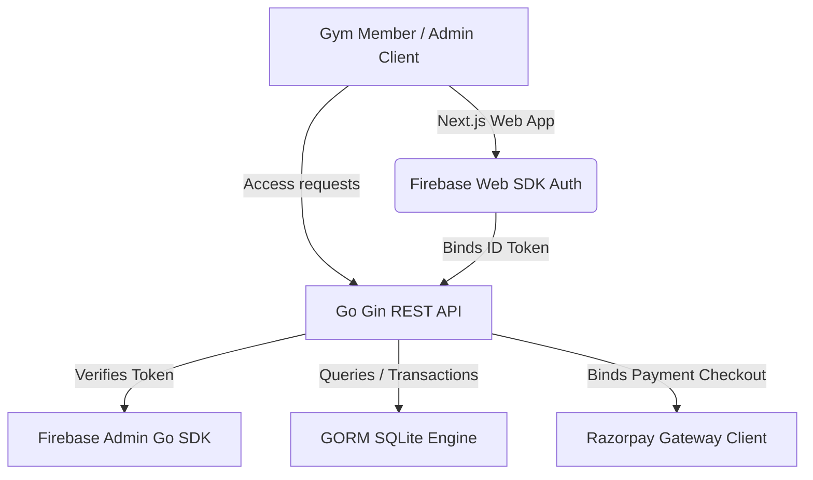

# GymPass Prime 🏋️‍♂️💳

[](https://golang.org)
[](https://nextjs.org)
[](https://react.dev)
[](https://gorm.io)
[](https://firebase.google.com)
[](https://razorpay.com)

**GymPass Prime** is a premium, high-performance physical facility access management and ticketing system. It allows gym administrators to configure subscriptions, register hourly packages, inspect payments logs, track floor check-ins, and verify security clearances via encrypted time-decay QR tokens.

Designed with a sleek **Matte Black and Gold Energy** aesthetic, the application features smooth transitions, 3D parallax illustrations, and a canvas-driven particle trail to offer a premium, modern experience.

---

## Key Features

* **Firebase Phone Authentication**: Secure, server-verified OTP authentication with reCAPTCHA protection.
* **Encrypted Time-Decay Access QR**: Dynamically rotating client-side QR codes expiring in 30 seconds to prevent key sharing.
* **Flexible Billing & Packages**:
  * **Hourly Packages**: Dynamic hours allocation modal (e.g. buy custom quantities of hours at a configured hourly rate).
  * **Monthly/Periodic Subscriptions**: Traditional date-range based validity access.
* **Interactive QR Check-In / Check-Out Console**: Simulator mimicking gym gate barcode hardware, tracking active workouts on the gym floor and automatically deducting hours.
* **Admin Control Center**:
  * Live monitoring of entries and floor presence.
  * Catalog manager for CRUD plan properties.
  * Real-time payment verification log.
  * User profile management (directory, activation, suspension).
  * System metadata configuration panel.
* **Matte Black 3D Visual System**: Parallax layers, glowing gold particle trails, and responsive grids.

---

## System Architecture



---

## Installation & Local Setup

### Prerequisite Environment
- **Go**: Version `1.22` or higher.
- **NodeJS**: Version `20` or higher.
- **SQLite**: Automatic setup managed by GORM.

---

### 1. Backend Server Setup

1. Navigate to the backend directory:
   ```bash
   cd backend
   ```
2. Copy the configuration environment variables template:
   ```bash
   cp .env.example .env
   ```
3. Edit the `.env` file with your credentials (e.g., your Razorpay IDs, Firebase Project ID):
   ```env
   PORT=8080
   JWT_SECRET=your_jwt_secret_key_here
   DB_DRIVER=sqlite
   DB_PATH=database/gympass.db
   RAZORPAY_KEY_ID=rzp_test_mock_id_123
   RAZORPAY_KEY_SECRET=rzp_test_mock_secret_abc
   ADMIN_EMAIL=admin@gympass.com
   ADMIN_PASSWORD=admin123
   ADMIN_PHONES="+919876543210,+919999999999"
   DEV_MODE=true
   FIREBASE_PROJECT_ID=gympass-587a1
   ```
4. Fetch dependencies and run the server (GORM will auto-migrate and seed the database tables):
   ```bash
   go run main.go
   ```

---

### 2. Frontend Web App Setup

1. Navigate to the frontend directory:
   ```bash
   cd ../frontend
   ```
2. Copy the environment variables template:
   ```bash
   cp .env.example .env.local
   ```
3. Add your Firebase Web config keys to `.env.local`:
   ```env
   NEXT_PUBLIC_API_URL=http://localhost:8080/api
   NEXT_PUBLIC_FIREBASE_API_KEY=your_firebase_api_key
   NEXT_PUBLIC_FIREBASE_AUTH_DOMAIN=your_firebase_auth_domain
   NEXT_PUBLIC_FIREBASE_PROJECT_ID=your_firebase_project_id
   NEXT_PUBLIC_FIREBASE_STORAGE_BUCKET=your_firebase_storage_bucket
   NEXT_PUBLIC_FIREBASE_MESSAGING_SENDER_ID=your_firebase_messaging_sender_id
   NEXT_PUBLIC_FIREBASE_APP_ID=your_firebase_app_id
   ```
4. Install npm packages and start the developer hot-reload server:
   ```bash
   npm install
   npm run dev
   ```
5. Open your browser to **`http://localhost:3000`**.

---

## Database Schema (GORM SQLite Entity Relationships)

* **Admins**: Store email and password hashes for direct administrative entrance logs.
* **Users**: Tracks phone number, onboarding data, active statuses, and `firebase_uid`.
* **Plans**: Subscription plans catalog (hourly/periodic validity, prices, default hours).
* **Payments**: Order records log connecting Razorpay checkouts, dynamic hours quantities, and verification signatures.
* **Purchases**: Active user packages, expiration limits, and remaining time balances.
* **Sessions**: Logs member floor workouts (check-in/check-out timestamps, elapsed seconds, hours deducted).
* **Settings**: Global facility parameters (gym name, hours, contact address, branding attributes).

---

## Core API Endpoints

### Public Gate
- `POST /api/auth/send-otp` — Dispatches SMS code (in sandbox, prints mock code to terminal).
- `POST /api/auth/verify-otp` — Validates Firebase ID tokens, maps user roles, and issues GymPass JWT.
- `POST /api/admin/login` — Direct credential login for administrators.

### Member Gate (JWT User Token required)
- `POST /api/user/onboard` — Records registration profile name, age, gender.
- `GET /api/user/dashboard` — Fetches active subscriptions and workout entries history.
- `GET /api/user/qr` — Generates a 30s decay cryptographically signed check-in token.
- `POST /api/user/payments/initiate` — Initiates Razorpay checkout orders for custom hours.
- `POST /api/user/payments/verify` — Validates Razorpay signatures and provisions the purchased hours.

### Admin Gate (JWT Admin Token required)
- `GET /api/admin/dashboard` — Total member counts, today's revenues, active floor check-ins.
- `GET /api/admin/users` — Browse member database, suspend, or reactivate accounts.
- `GET/POST/PUT/DELETE /api/admin/plans` — Catalog plans manager.
- `GET /api/admin/payments` — Transacted checkout history inspector.
- `GET /api/admin/sessions` — Active gym floor check-in monitoring.
- `PUT /api/admin/settings` — Configure gym details, working hours, and branding parameters.

---

## Future Release Roadmap
- **Production Migrations**: PostgreSQL driver option settings for heavy concurrency.
- **Native Webcam Scanning**: Integrations of visual scan readers on tablet stands.
- **Active Notifications Hook**: Integration of Twilio SMS / WhatsApp check-in summaries.

---

## License
Distributed under the MIT License. See `LICENSE` for more information.

---

## Authors & Contributors
Developed by a team of professional software engineers, dedicated to modern, premium, and reliable access control solutions. 🚀
